# Flujo de la Aplicación - Lab06 API Cursos

> Documentación visual de la arquitectura, ciclos de petición-respuesta y flujos de decisión.
> Los diagramas usan **Mermaid** y son renderizables directamente en GitHub/GitLab/VS Code.

---

## 1. Arquitectura por Capas

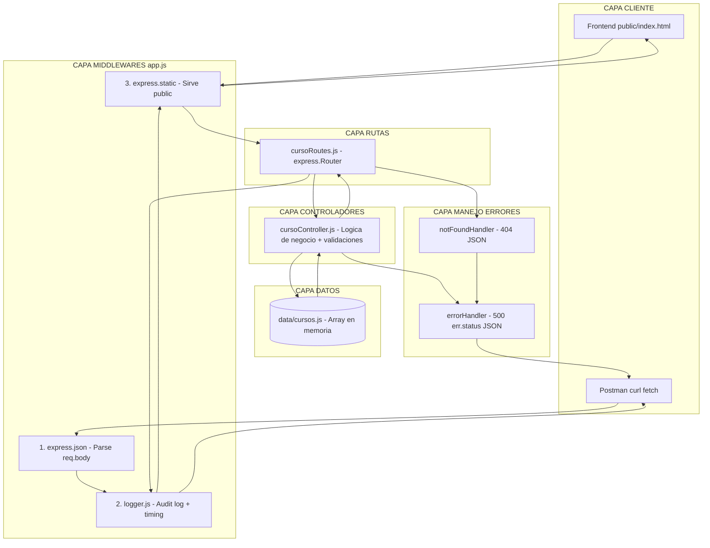

**Explicación del flujo por capas:**

| Capa | Archivos | Responsabilidad | Flujo |
|------|----------|-----------------|-------|
| **1. Cliente** | `public/index.html`, Postman, curl | Consume la API vía HTTP | Inicia petición |
| **2. Middlewares** | `app.js` → `express.json()`, `logger.js`, `express.static` | Procesamiento transversal | `json` parsea body → `logger` mide tiempo → `static` sirve frontend |
| **3. Rutas** | `routes/cursoRoutes.js` | Mapea verbos/URLs a controladores | `express.Router()` delega al controlador |
| **4. Controladores** | `controllers/cursoController.js` | Lógica de negocio, validaciones, respuestas | Accede a datos, construye respuesta |
| **5. Datos** | `data/cursos.js` | Persistencia en memoria | `push`, `splice`, `find`, `filter` |
| **6. Errores** | `middlewares/errorHandler.js` | 404 (rutas) + 500/err.status (excepciones) | Captura al final de la cadena |

**Orden crítico en `app.js`:**
```javascript
app.use(express.json());      // 1º: Parse body ANTES de controladores
app.use(logger);              // 2º: Log TODAS las peticiones
app.use(express.static('public')); // 3º: Frontend ANTES que 404
app.use('/api/cursos', router);    // 4º: Rutas API
app.use(notFoundHandler);     // 5º: 404 si ninguna ruta matchea
app.use(errorHandler);        // 6º: Último - captura next(err)
```

---

## 2. Ciclo de Vida de una Petición (Secuencia General)

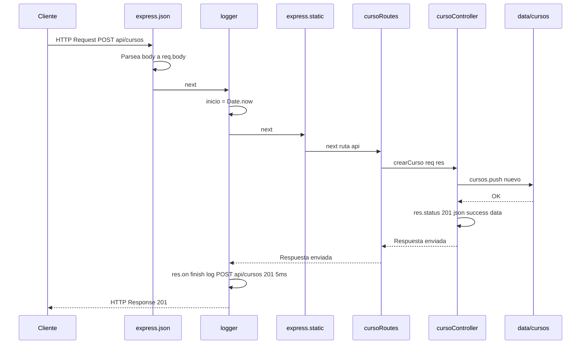

---

## 3. Secuencia por Endpoint

### 3.1 GET `/api/cursos` (lista + filtro `?creditos=`)

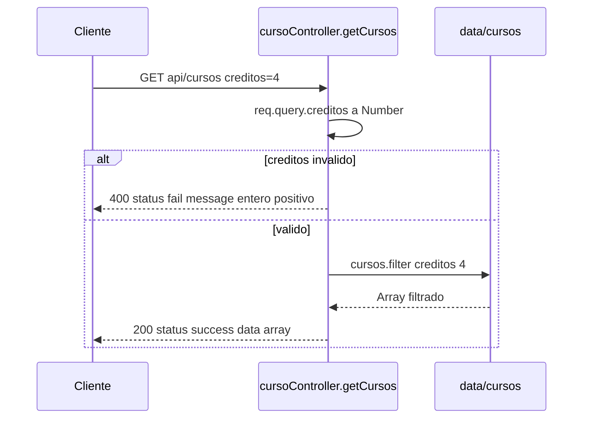
**Uso:** `req.query` para filtros opcionales.

---

### 3.2 GET `/api/cursos/:id`

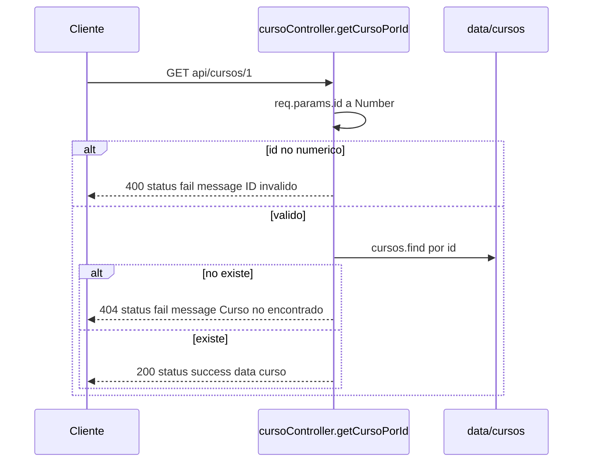
**Uso:** `req.params` para identificar recurso único.

---

### 3.3 POST `/api/cursos`

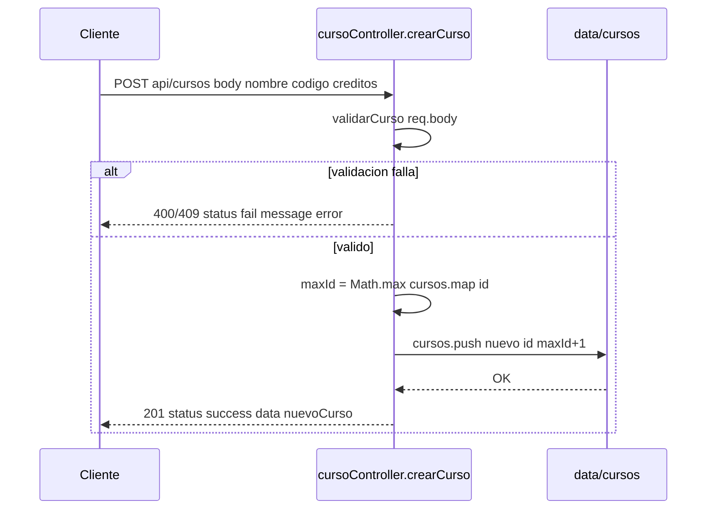
**Uso:** `req.body` para datos del nuevo recurso.

---

### 3.4 PUT `/api/cursos/:id`

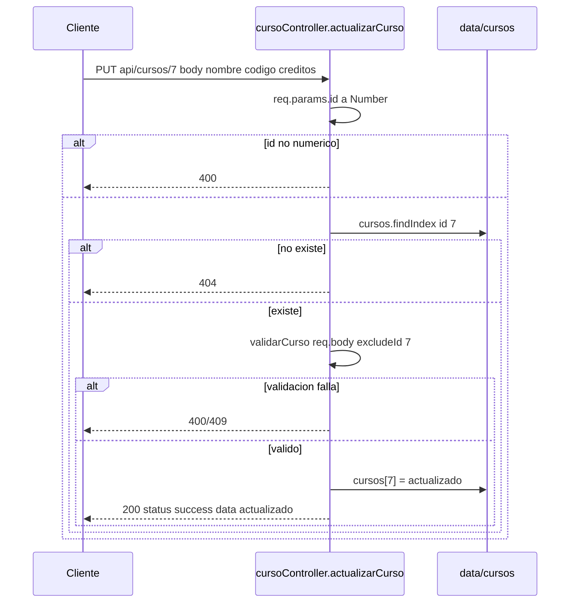
**Uso:** `req.params` (id) + `req.body` (datos completos).

---

### 3.5 DELETE `/api/cursos/:id`

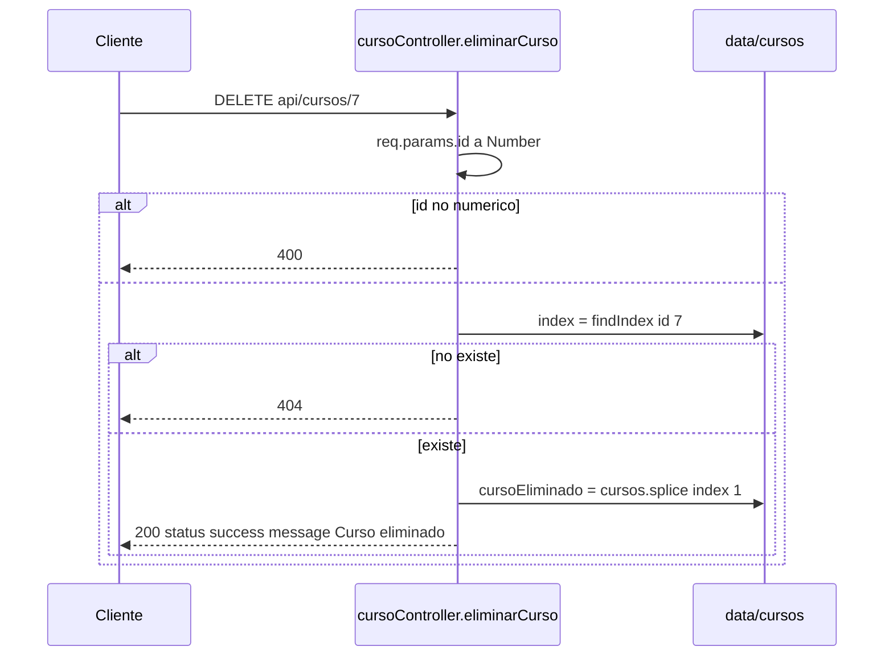
**Uso:** `req.params` para identificar recurso a eliminar.

---

## 4. Diagramas de Flujo de Decisiones

### 4.1 POST `/api/cursos` - Validaciones

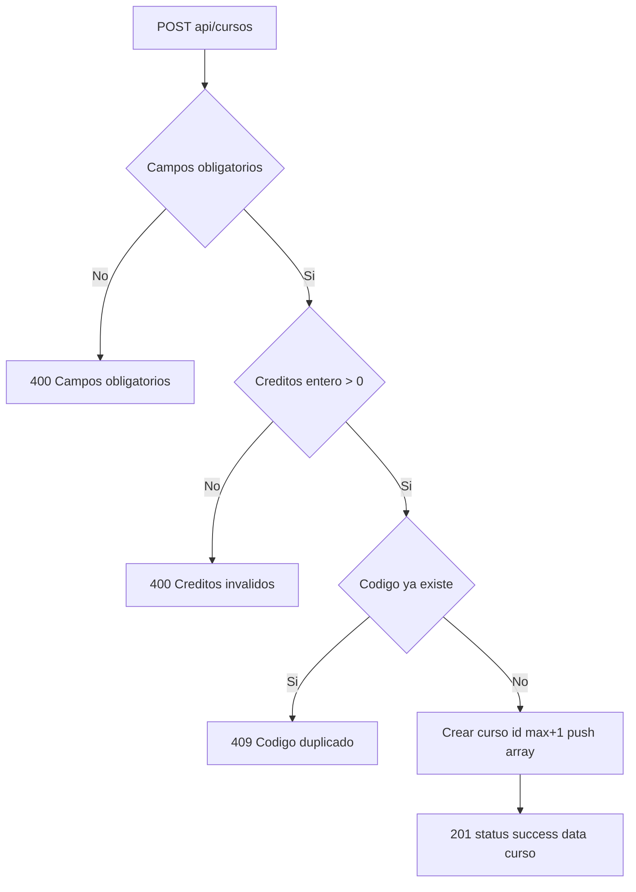

### 4.2 GET `/api/cursos/:id` - Búsqueda

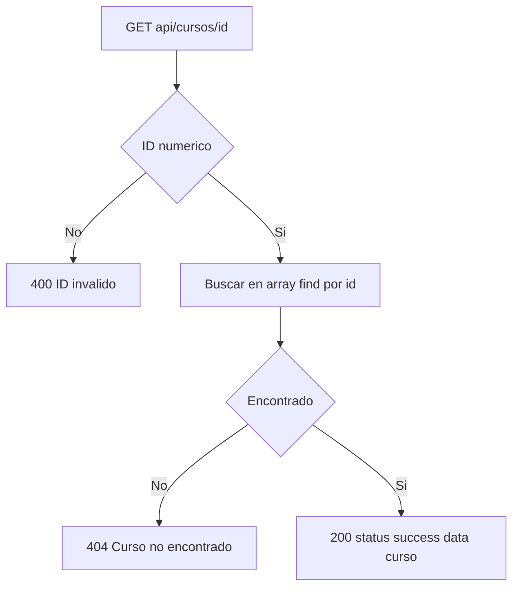

---

## 5. Manejo de Errores (Error Handler)

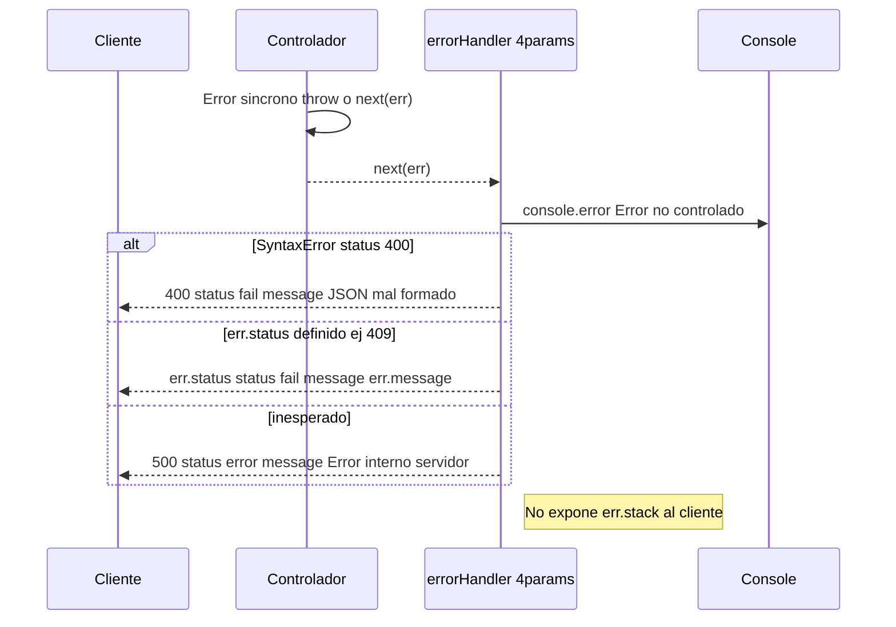

---

## 6. Orden de Middlewares y Por Qué Importa

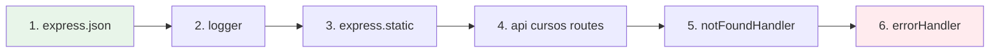

| Orden | Middleware | Por qué en esa posición |
|-------|------------|------------------------|
| 1 | `express.json()` | Debe parsear `req.body` **antes** de que controladores lo lean. Si va después, `req.body` es `undefined`. |
| 2 | `logger` | Registra **todas** las peticiones (incluye estáticas y API). Debe estar antes de rutas para medir tiempo total. |
| 3 | `express.static('public')` | Sirve frontend en `/`. Debe ir **antes** del 404 para que archivos estáticos no caigan en "ruta no encontrada". |
| 4 | `/api/cursos` routes | Rutas de la API. Solo llegan aquí peticiones no estáticas. |
| 5 | `notFoundHandler` | Captura rutas no definidas (ej. `/api/otra`). Debe ir **después** de todas las rutas reales. |
| 6 | `errorHandler` | Último: captura errores de cualquier middleware anterior (`next(err)`). Firma de 4 params obligatoria. |

**Regla de oro:** Middlewares se ejecutan **en orden de registro**. `next()` pasa al siguiente; `next(err)` salta directo al `errorHandler`.

---

## 7. Tabla de Códigos HTTP Usados

| Código | Nombre | Cuándo se devuelve |
|--------|--------|-------------------|
| **200** | OK | GET exitoso, PUT exitoso, DELETE exitoso (con mensaje) |
| **201** | Created | POST exitoso (recurso creado) |
| **400** | Bad Request | JSON mal formado, campos faltantes, créditos inválidos, ID no numérico, query `creditos` no numérico |
| **404** | Not Found | Curso por ID no existe, ruta inexistente |
| **409** | Conflict | Código de curso duplicado (POST/PUT) |
| **500** | Internal Server Error | Error no controlado (excepción no capturada) |

---

## 8. Ejemplo Paso a Paso: POST `/api/cursos` Válido

### Petición
```http
POST /api/cursos HTTP/1.1
Host: localhost:3000
Content-Type: application/json

{"nombre":"Redes","codigo":"INF301","creditos":3}
```

### Qué ocurre en el servidor

1. **express.json()** parsea el body → `req.body = {nombre:"Redes", codigo:"INF301", creditos:3}`
2. **logger** registra `inicio = Date.now()` (ej. 1700000000000)
3. **Router** matchea `POST /api/cursos` → llama `crearCurso(req, res)`
4. **Controlador**:
   - `validarCurso()` → todo OK
   - `maxId = 6` → `nuevoId = 7`
   - `cursos.push({id:7, nombre:"Redes", codigo:"INF301", creditos:3})`
   - `res.status(201).json({status:'success', data:{id:7,...}})`
5. **logger** evento `finish`:
   - `duracion = Date.now() - inicio` (ej. 4 ms)
   - Imprime en consola:
     ```
     2026-10-11T15:30:00.000Z | POST /api/cursos - 201 - 4 ms
     ```
6. **Cliente** recibe:
   ```json
   {
     "status": "success",
     "data": {
       "id": 7,
       "nombre": "Redes",
       "codigo": "INF301",
       "creditos": 3
     }
   }
   ```

---

## 9. Resumen del Flujo de Datos

```
┌─────────────┐     ┌──────────────┐     ┌────────────────┐     ┌────────────┐
│   Cliente   │────▶│  Middlewares │────▶│   Controlador  │────▶│   Datos    │
│  (HTTP)     │     │  (json, log, │     │  (validación,  │     │ (memoria)  │
└─────────────┘     │   static)    │     │   lógica)      │     └────────────┘
                    └──────────────┘     └────────────────┘            │
                            │                      │                   │
                            ▼                      ▼                   ▼
                     ┌──────────────┐     ┌────────────────┐     ┌────────────┐
                     │   Logger     │     │   Respuesta    │     │  push /    │
                     │  (finish)    │◀────│  JSON uniforme │     │  splice /  │
                     └──────────────┘     └────────────────┘     │  find      │
                                                                  └────────────┘
```

---

> **Nota:** Todos los diagramas Mermaid son compatibles con GitHub, GitLab, VS Code (extensión *Markdown Preview Mermaid Support*) y herramientas de documentación como MkDocs/Mermaid.js.